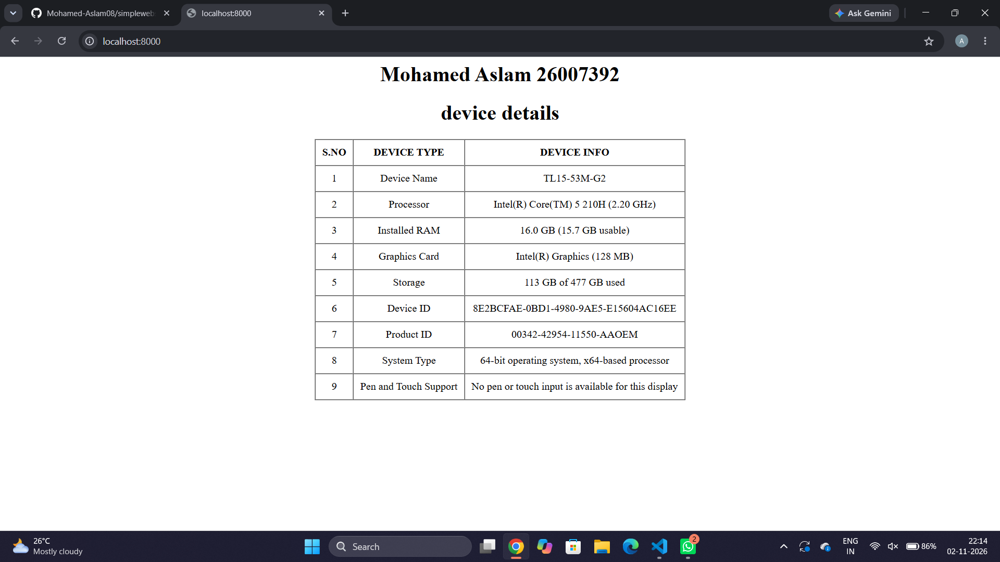
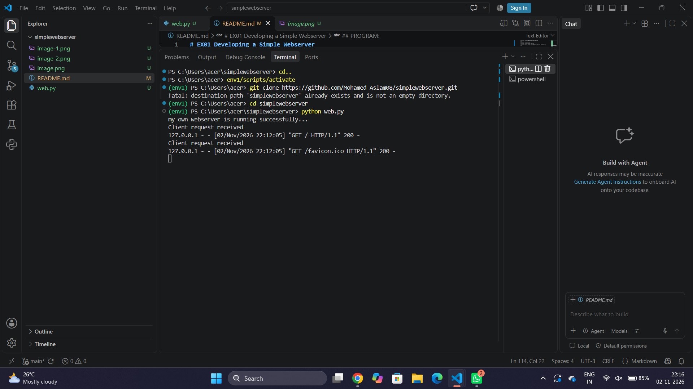

# EX01 Developing a Simple Webserver
## Date:28.09.2026

## AIM:
To develop a simple webserver to serve html pages and display the Windows Specifications of your Laptop.

## DESIGN STEPS:
### Step 1: 
HTML content creation.

### Step 2:
Design of webserver workflow.

### Step 3:
Implementation using Python code.

### Step 4:
Import the necessary modules.

### Step 5:
Define a custom request handler.

### Step 6:
Start an HTTP server on a specific port.

### Step 7:
Run the Python script to serve web pages.

### Step 8:
Serve the HTML pages.

### Step 9:
Start the server script and check for errors.

### Step 10:
Open a browser and navigate to http://127.0.0.1:8000 (or the assigned port).

## PROGRAM:
```
from http.server import HTTPServer, BaseHTTPRequestHandler
content = """
<html>
   <head>
      <title>localhost:8000</title>
      <h1 align="center">Mohamed Aslam 26007392</h1>
      <h1 align="center">device details</h1>
   </head>
   <body>
    <table border="1" align="center" cellpadding="10" cellspacing="0">
         <tr>
            <th align = "center">S.NO</th>
            <th align = "center">DEVICE TYPE</th>
            <th align = "center">DEVICE INFO</th>
            </tr>
            <tr>
            <td align = "center">1</td>
            <td align = "center">Device Name</td>
            <td align = "center">TL15-53M-G2</td>
            </tr>
            <tr>
            <td align = "center">2</td>
            <td align = "center">Processor</td>
            <td align = "center">Intel(R) Core(TM) 5 210H (2.20 GHz)</td>
            </tr>
            <tr>
            <td align = "center">3</td>
            <td align = "center">Installed RAM</td>
            <td align = "center">16.0 GB (15.7 GB usable)</td>
            </tr>
            <tr>
            <td align = "center">4</td>
            <td align = "center">Graphics Card</td>
            <td align = "center">Intel(R) Graphics (128 MB)</td>
            </tr>
            <tr>
            <td align = "center">5</td>
            <td align = "center">Storage</td>
            <td align = "center">113 GB of 477 GB used</td>
            </tr>
            <tr>
            <td align = "center">6</td>
            <td align = "center">Device ID</td>
            <td align = "center">8E2BCFAE-0BD1-4980-9AE5-E15604AC16EE</td>
            </tr>
            <tr>
            <td align = "center">7</td>
            <td align = "center">Product ID</td>
            <td align = "center">00342-42954-11550-AAOEM</td>
            </tr>
            <tr>
            <td align = "center">8</td>
            <td align = "center">System Type</td>
            <td align = "center">64-bit operating system, x64-based processor</td>
            </tr>
            <tr>
            <td align = "center">9</td>
            <td align = "center">Pen and Touch Support</td>
            <td align = "center">No pen or touch input is available for this display</td>
            </tr>
    </table>
   </body
</html>
"""
class myhandler(BaseHTTPRequestHandler):
    def do_GET(self):
        print("Client request received")
        self.send_response(200)
        self.send_header('content-type', 'text/html; charset=utf-8')
        self.end_headers()
        self.wfile.write(content.encode())
server_address = ('',8000)
httpd = HTTPServer(server_address,myhandler)
print("my own webserver is running successfully...")
httpd.serve_forever()


```

## OUTPUT
webpage


web server



## RESULT:
The program for implementing simple webserver is executed successfully.
